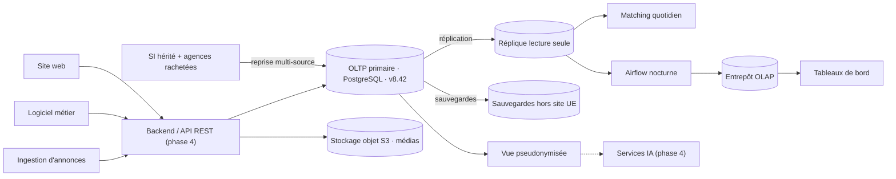

# Dossier d'architecture cible — absorber la croissance

> **Livrable :** Phase 3 · BC01 — grille d'évaluation : « 1 schéma de composants + 1 matrice de décision + 2-3 pages ».
> **Rédaction :** Matthieu Barre (R) · **Approbation :** Thérèse Nguyen (A) — mêmes rôles dans les trois versions du RACI. **Consultés :** Alexandre Kechaf ; Angeline Gomez, auteure de la matrice et de la SWOT de croissance.
> **Version :** 1.1 du 13/10/2026 · **Statut :** proposé, à valider en atelier.
> **Ce dossier assemble, il ne remplace pas.** Exigences : *Cahier des charges technique* v1.2 (Angeline Gomez). Décision chiffrée : *Matrice de décision — architecture de croissance*. Diagnostic : *SWOT — diagnostic d'architecture de croissance*. Vision : *SI cible / ImmoHunter* et *Graphique SI cible* (Alexandre Kechaf). Ce dossier ajoute le rôle de chaque composant, le comparatif des architectures demandé par l'énoncé, la réponse aux exigences, et des **mesures** sur le socle réel.

## 1. Schéma de composants

*Image `schema-composants.png`, source Mermaid versionnée : [`schema-composants.mmd`](schema-composants.mmd).* Vert : réalisé · jaune : maquetté · gris pointillé : à construire.

Il reprend l'architecture imposée par le cahier des charges technique (§3 : l'API seul point d'accès, l'IA par une vue pseudonymisée) et y ajoute les composants de croissance de la matrice : réplique, sauvegardes, entrepôt alimenté depuis la réplique.

## 2. Composants

| Composant | Fonction | Dépend de | État au 13/10 | Preuve |
| --- | --- | --- | --- | --- |
| **OLTP primaire** | Source de vérité ; porte les règles métier | — | ✅ réalisé, v8.42 | 38 tables ; 34 rejets testés, 37 en v8.43 |
| **Reprise multi-source** | Charge l'existant et chaque agence rachetée | OLTP | ✅ réalisé | 48 tests de migration |
| **Entrepôt OLAP** | Indicateurs de pilotage hors production | vues d'état de l'OLTP | ✅ réalisé, dans la même instance pour l'instant | 11 tests, rapprochements OLTP/OLAP |
| **Stockage objet S3** | Fichiers hors base ; la base garde clé, URI, empreinte | table `document` | 🟡 maquette du 12/10 | [note maquette MinIO](note-maquette-minio.md) |
| **Réplique** | Lectures lourdes ; secours en cas de panne | primaire, hébergeur | ⏳ cible, décision de la matrice | — |
| **Sauvegardes** | Protègent de l'erreur humaine, que la réplique recopie | hébergeur UE | ⏳ cible | PCA/PRA (Thérèse) |
| **Airflow** | Orchestre le chargement nocturne | réplique, entrepôt | ⏳ cible | script de chargement déjà idempotent |
| **API, matching, IA** | Parcours applicatif et futur IA | OLTP, réplique, vue pseudonymisée | ⏳ phase 4 | — |

**Dépendance critique.** Tout repose sur l'OLTP primaire, point unique de défaillance (SWOT, Fa1). Réplique et sauvegardes sont deux parades qui ne se remplacent pas : une suppression erronée est recopiée sur la réplique dans la seconde.

## 3. Comparatif des architectures demandé par l'énoncé

| Architecture | Principe | Bon cas d'usage | Chez nous | Preuve |
| --- | --- | --- | --- | --- |
| **OLTP / OLAP séparés** | Une base pour travailler, une pour analyser | Indicateurs lourds qui ralentiraient la production | **Retenu**, imposé par l'énoncé | entrepôt livré, PR #15 |
| **Indexation** | Des sommaires qui évitent de tout relire | Requêtes fréquentes et sélectives | **Retenu** : 8 index, chacun justifié par une requête (ENF-26) | note d'indexation ; DDL en v8.43 (PR #16) |
| **Réplication** | Une copie à jour, en lecture | Lectures lourdes, continuité de service | **Retenu** comme cible (option B) | matrice § 6 |
| **Partitionnement** | Couper une table par intervalle | Requêtes et purges par période | **En réserve** : incompatible avec le modèle sans reprise de données | test du 13/10, § 4 |
| **Sharding** | Répartir les données sur plusieurs serveurs | Écritures qui saturent un serveur | **Écarté** : écritures projetées faibles, ≈ 8 associations/s en hypothèse haute | SWOT de croissance § 4 |

## 4. Mesures

**Indexation.** Jeu valide : 20 000 mandats, 100 000 biens et annonces, 60 000 propositions, 120 000 visites. PostgreSQL 16.15, une seule session.

| Requête représentative | Sans index | Avec index | Avec index et réglage SSD |
| --- | --- | --- | --- |
| Mandats actifs d'un chasseur | 2 978 ms | 55 ms | 64 ms |
| Critères du barème sur 12 mois | 6,4 ms | 0,2 ms | 0,2 ms |
| Matching : annonces d'une zone et d'un budget | 48 ms | **61 ms** | **18 ms** |
| Rendez-vous de visite d'un mandat | 73 ms | 0,2 ms | 0,2 ms |

Le matching montre qu'un index ne suffit pas : avec le réglage par défaut, prévu pour des disques mécaniques, le planificateur l'ignore et la requête ralentit. Le réglage du coût d'accès aléatoire pour un SSD est donc une **condition**, pas une option.

**Partitionnement**, testé sur le DDL réel avec deux découpes. Script rejouable, sans effet sur la base : [`test-partitionnement.sql`](test-partitionnement.sql).

| Vérification | Par identifiant UUIDv7 | Par période (ENF-04) |
| --- | --- | --- |
| Clé primaire actuelle | ✅ conservée | ❌ doit inclure la date |
| Clés étrangères de 4 tables vers `proposition` | ✅ conservées | ❌ la date doit y être recopiée : reprise de données |
| Règle « un bien proposé une fois tant que la proposition vit » | ❌ sort de la base | ❌ sort de la base |
| Dédoublonnage des annonces ingérées | ❌ sort de la base | ❌ sort de la base |
| Requête « propositions d'un mandat » | ❌ toutes les partitions lues | ❌ toutes les partitions lues |
| Requête par période de matching | ❌ toutes les partitions lues | ✅ une seule partition lue |

**Conséquence.** Les conditions 1 et 2 du § 6 de la matrice échouent, et l'exigence ENF-04 (« partitionnables par période sans reprise de données ») n'est pas tenable avec le modèle v8.42 : c'est la réponse au point ouvert PO-15 du cahier des charges.

## 5. Réponse aux exigences du cahier des charges technique

| Exigence | Réponse de l'architecture | État |
| --- | --- | --- |
| **ENF-01** sélection < 2 s sur 2 000 000 de biens, 20 req/s | Index de matching + réglage SSD ; lectures servies par la réplique | 🟡 18 ms mesurés sur 100 000 biens, en une session : encourageant, **pas une preuve** |
| **ENF-02** rémunération < 2 s sur 780 000 mandats | Index par chasseur et par mandat | 🟡 < 1 ms par critère sur 20 000 mandats, à prouver au volume |
| **ENF-03** 5 000 mandats/semaine, 70 000 annonces/jour | Une instance suffit en écriture ; lectures déportées | 🟡 hypothèse, non mesurée |
| **ENF-04** partitionnable sans reprise | — | ❌ non tenable, § 4 : **à amender** |
| **ENF-06, ENF-24** RPO/RTO, sauvegarde par nature | Réplique + sauvegardes hors site | ⏳ PCA/PRA |
| **ENF-07, ENF-08** intégrité par le SGBD | Contraintes et gardes dans la base | ✅ testé |
| **ENF-20** IA par vue pseudonymisée | Vue dédiée en lecture seule | ⏳ phase 4 |
| **ENF-25, ENF-29, ENF-38** médias hors base, liens signés, réversibilité | Stockage objet S3, empreinte en base | 🟡 maquette ; liens signés à faire |
| **ENF-26** chaque index justifié | Note d'indexation | ✅ |

**Ce que les mesures ne prouvent pas.** Le jeu est 20 fois plus petit que le stock de biens de référence (2 000 000) et 250 fois plus petit pour les propositions (15 000 000 sur 3 ans), sans charge concurrente. ENF-01 à ENF-03 restent à démontrer sur le jeu de recette au volume que le cahier prévoit (§ 6.1).

## 6. Améliorations proposées

| # | Amélioration | Porteur | Déclencheur |
| --- | --- | --- | --- |
| 1 | Régler le coût d'accès aléatoire pour SSD dans la configuration de l'instance | exploitation | dès la mise en production |
| 2 | Ne jamais lire la vue d'état des mandats en entier : 12,6 s sur 20 000 mandats. L'API filtre ; les listes complètes passent par l'entrepôt | backend | contrat d'API |
| 3 | Amender ENF-04 : partitionnement en réserve, accepté avec reprise de données s'il devient nécessaire | équipe, Angeline | atelier |
| 4 | Seuil de déclenchement du partitionnement : ENF-01 dépassée en recette au volume | Matthieu, Angeline | note 3V |
| 5 | Porter le jeu de volume aux grandeurs du cahier (§ 2) et y ajouter un test de charge | Matthieu | phase 3 |
| 6 | Stockage objet S3 managé européen, liens signés à durée limitée | équipe | choix de l'hébergeur |

## 7. Limites

Une seule session, pas de test de charge. Réplique, bascule et sauvegardes non testées : leurs objectifs relèvent du PCA/PRA. Le constat MinIO (image officielle plus librement distribuée, console retirée des versions gratuites) date du 12/10 et motive l'amélioration 6.
