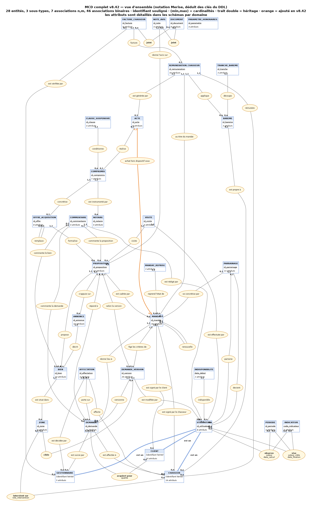
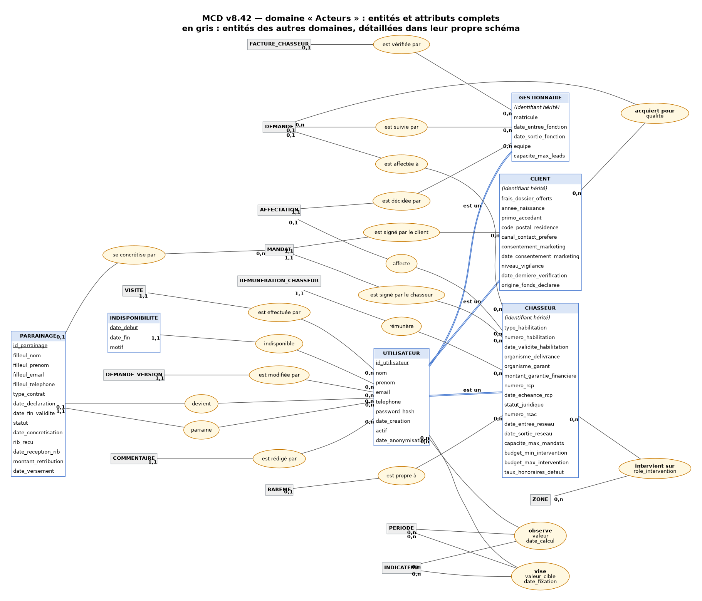
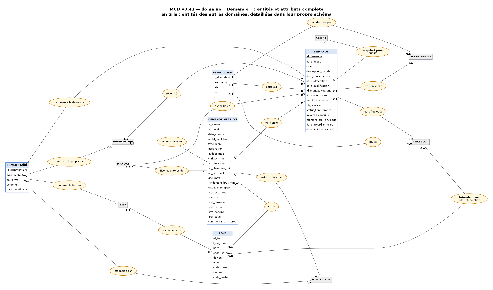
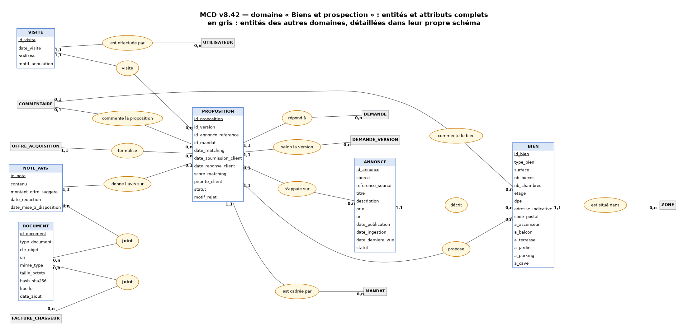
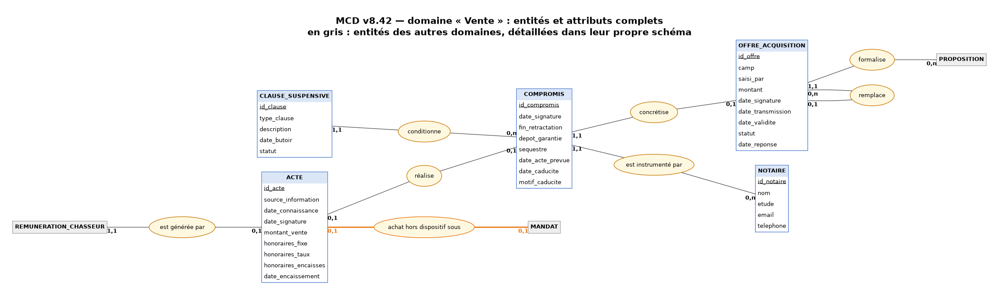
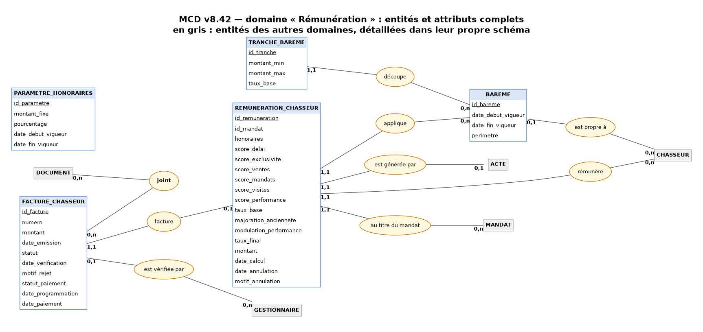
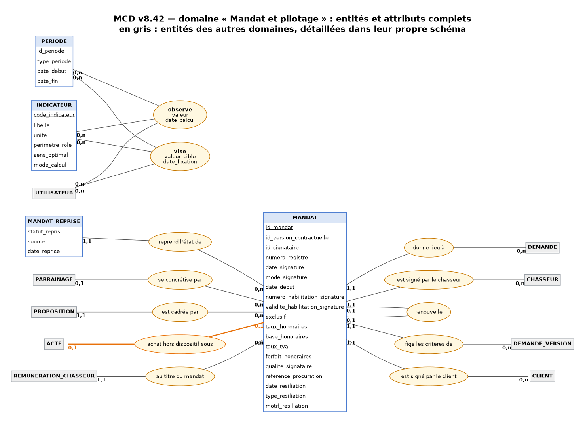

# MCD complet — v8.42 (vue de contrôle générée depuis le DDL)

> ⚙️ **Schémas et tableaux GÉNÉRÉS depuis `livrables/db/01_ddl.sql`** par `sources/generer_mcd.py` : les cardinalités sont
> déduites des clés (NOT NULL, UNIQUE, clés étrangères) et ne peuvent pas dériver du schéma réel. La section
> « Justifications » est rédigée à la main (`sources/mcd-justifications.md`).

> **Statut méthodologique.** En Merise, le MCD précède le MLD et le MPD : les MCD de **conception** sont ceux de
> l'atelier de convergence d'août 2026 (Confluence, « MCD - Mermaid Code #01 ») et du dossier de modélisation (§3).
> Ce document est une **rétro-ingénierie du schéma réel** : il sert de vue de contrôle à jour, pour vérifier que
> le modèle implémenté est bien celui qui a été conçu, et pour retrouver chaque choix débattu. Il ne remplace pas
> la démarche de conception, il la vérifie.

**28 entités, 3 sous-types, 7 associations n,m, 46 associations binaires, 7 contraintes d'intégrité fonctionnelle.** Lecture Merise : une entité porte son identifiant (souligné) et ses attributs ;
les clés étrangères du MLD n'apparaissent pas comme attributs, elles sont les associations.

## Vue d'ensemble

## Schémas par domaine (attributs complets)

### Acteurs

### Demande

### Biens et prospection

### Vente

### Rémunération

### Mandat et pilotage

## Entités et identifiants

| Entité | Identifiant | Attributs (hors clés étrangères) |
|---|---|---|
| `utilisateur` | `id_utilisateur` | `nom`, `prenom`, `email`, `telephone`, `password_hash`, `date_creation`, `actif`, `date_anonymisation` |
| `indisponibilite` | `date_debut` | `date_fin`, `motif` |
| `zone` | `id_zone` | `type_zone`, `pays`, `code_iso_pays`, `devise`, `ville`, `code_insee`, `secteur`, `code_postal` |
| `demande` | `id_demande` | `date_depot`, `canal`, `description_initiale`, `date_consentement`, `date_affectation`, `date_qualification`, `id_mandat_courant`, `date_sans_suite`, `motif_sans_suite`, `nb_relances`, `statut_financement`, `apport_disponible`, `montant_pret_envisage`, `date_accord_principe`, `date_validite_accord` |
| `affectation` | `id_affectation` | `date_debut`, `date_fin`, `motif` |
| `demande_version` | `id_version` | `no_version`, `date_creation`, `motif_evolution`, `type_bien`, `destination`, `budget_max`, `surface_min`, `nb_pieces_min`, `nb_chambres_min`, `nb_occupants`, `dpe_max`, `rendement_brut_min`, `travaux_acceptes`, `pref_ascenseur`, `pref_balcon`, `pref_terrasse`, `pref_jardin`, `pref_parking`, `pref_cave`, `commentaire_criteres` |
| `mandat` | `id_mandat` | `id_version_contractuelle`, `id_signataire`, `numero_registre`, `date_signature`, `mode_signature`, `date_debut`, `numero_habilitation_signature`, `validite_habilitation_signature`, `exclusif`, `taux_honoraires`, `base_honoraires`, `taux_tva`, `forfait_honoraires`, `qualite_signataire`, `reference_procuration`, `date_resiliation`, `type_resiliation`, `motif_resiliation` |
| `mandat_reprise` | — | `statut_repris`, `source`, `date_reprise` |
| `parrainage` | `id_parrainage` | `filleul_nom`, `filleul_prenom`, `filleul_email`, `filleul_telephone`, `type_contrat`, `date_declaration`, `date_fin_validite`, `statut`, `date_concretisation`, `rib_recu`, `date_reception_rib`, `montant_retribution`, `date_versement` |
| `bien` | `id_bien` | `type_bien`, `surface`, `nb_pieces`, `nb_chambres`, `etage`, `dpe`, `adresse_indicative`, `code_postal`, `a_ascenseur`, `a_balcon`, `a_terrasse`, `a_jardin`, `a_parking`, `a_cave` |
| `annonce` | `id_annonce` | `source`, `reference_source`, `titre`, `description`, `prix`, `url`, `date_publication`, `date_ingestion`, `date_derniere_vue`, `statut` |
| `proposition` | `id_proposition` | `id_version`, `id_annonce_reference`, `id_mandat`, `date_matching`, `date_soumission_client`, `date_reponse_client`, `score_matching`, `priorite_client`, `statut`, `motif_rejet` |
| `commentaire` | `id_commentaire` | `type_contexte`, `est_prive`, `contenu`, `date_creation` |
| `visite` | `id_visite` | `date_visite`, `realisee`, `motif_annulation` |
| `offre_acquisition` | `id_offre` | `camp`, `saisi_par`, `montant`, `date_signature`, `date_transmission`, `date_validite`, `statut`, `date_reponse` |
| `notaire` | `id_notaire` | `nom`, `etude`, `email`, `telephone` |
| `compromis` | `id_compromis` | `date_signature`, `fin_retractation`, `depot_garantie`, `sequestre`, `date_acte_prevue`, `date_caducite`, `motif_caducite` |
| `clause_suspensive` | `id_clause` | `type_clause`, `description`, `date_butoir`, `statut` |
| `acte` | `id_acte` | `source_information`, `date_connaissance`, `date_signature`, `montant_vente`, `honoraires_fixe`, `honoraires_taux`, `honoraires_encaisses`, `date_encaissement` |
| `bareme` | `id_bareme` | `date_debut_vigueur`, `date_fin_vigueur`, `perimetre` |
| `tranche_bareme` | `id_tranche` | `montant_min`, `montant_max`, `taux_base` |
| `parametre_honoraires` | `id_parametre` | `montant_fixe`, `pourcentage`, `date_debut_vigueur`, `date_fin_vigueur` |
| `remuneration_chasseur` | `id_remuneration` | `id_mandat`, `honoraires`, `score_delai`, `score_exclusivite`, `score_ventes`, `score_mandats`, `score_visites`, `score_performance`, `taux_base`, `majoration_anciennete`, `modulation_performance`, `taux_final`, `montant`, `date_calcul`, `date_annulation`, `motif_annulation` |
| `facture_chasseur` | `id_facture` | `numero`, `montant`, `date_emission`, `statut`, `date_verification`, `motif_rejet`, `statut_paiement`, `date_programmation`, `date_paiement` |
| `note_avis` | `id_note` | `contenu`, `montant_offre_suggere`, `date_redaction`, `date_mise_a_disposition` |
| `document` | `id_document` | `type_document`, `cle_objet`, `uri`, `mime_type`, `taille_octets`, `hash_sha256`, `libelle`, `date_ajout` |
| `indicateur` | `code_indicateur` | `libelle`, `unite`, `perimetre_role`, `sens_optimal`, `mode_calcul` |
| `periode` | `id_periode` | `type_periode`, `date_debut`, `date_fin` |

## Sous-types (héritage par clé partagée)

| Sous-type | Sur-type | Attributs propres |
|---|---|---|
| `client` | `utilisateur` | `frais_dossier_offerts`, `annee_naissance`, `primo_accedant`, `code_postal_residence`, `canal_contact_prefere`, `consentement_marketing`, `date_consentement_marketing`, `niveau_vigilance`, `date_derniere_verification`, `origine_fonds_declaree` |
| `chasseur` | `utilisateur` | `type_habilitation`, `numero_habilitation`, `date_validite_habilitation`, `organisme_delivrance`, `organisme_garant`, `montant_garantie_financiere`, `numero_rcp`, `date_echeance_rcp`, `statut_juridique`, `numero_rsac`, `date_entree_reseau`, `date_sortie_reseau`, `capacite_max_mandats`, `budget_min_intervention`, `budget_max_intervention`, `taux_honoraires_defaut` |
| `gestionnaire` | `utilisateur` | `matricule`, `date_entree_fonction`, `date_sortie_fonction`, `equipe`, `capacite_max_leads` |

## Associations n,m (tables de liaison)

| Association | Entités liées | Attributs portés |
|---|---|---|
| `demande_acquereur` (« acquiert pour ») | `demande` × `client` | `qualite` |
| `version_zone` (« cible ») | `demande_version` × `zone` | — |
| `chasseur_zone` (« intervient sur ») | `chasseur` × `zone` | `role_intervention` |
| `note_avis_document` (« joint ») | `note_avis` × `document` | — |
| `facture_document` (« joint ») | `facture_chasseur` × `document` | — |
| `observation` (« observe ») | `utilisateur` × `indicateur` × `periode` | `valeur`, `date_calcul` |
| `objectif` (« vise ») | `utilisateur` × `indicateur` × `periode` | `valeur_cible`, `date_fixation` |

## Associations binaires et cardinalités

Cardinalité côté porteur : **(1,1)** si la clé étrangère est obligatoire, **(0,1)** sinon. Côté référencé : **(0,1)** si elle est unique, **(0,n)** sinon.

| Entité porteuse | Association | Entité référencée | Porteur | Référencé | Colonne (MLD) |
|---|---|---|---|---|---|
| `indisponibilite` | indisponible | `utilisateur` | (1,1) | (0,n) | `id_utilisateur` |
| `demande` | est suivie par | `gestionnaire` | (0,1) | (0,n) | `id_gestionnaire` |
| `demande` | est affectée à | `chasseur` | (0,1) | (0,n) | `id_chasseur` |
| `affectation` | porte sur | `demande` | (1,1) | (0,n) | `id_demande` |
| `affectation` | est décidée par | `gestionnaire` | (1,1) | (0,n) | `id_gestionnaire` |
| `affectation` | affecte | `chasseur` | (0,1) | (0,n) | `id_chasseur` |
| `demande_version` | versionne | `demande` | (1,1) | (0,n) | `id_demande` |
| `demande_version` | est modifiée par | `utilisateur` | (1,1) | (0,n) | `id_modifie_par` |
| `mandat` | donne lieu à | `demande` | (1,1) | (0,n) | `id_demande` |
| `mandat` | est signé par le chasseur | `chasseur` | (1,1) | (0,n) | `id_chasseur` |
| `mandat` | renouvelle | `mandat` | (0,1) | (0,1) | `id_mandat_precedent` |
| `mandat` | fige les critères de | `demande_version` | (1,1) | (0,n) | `id_version_contractuelle` — FK composée fk_mandat_version |
| `mandat` | est signé par le client | `client` | (1,1) | (0,n) | `id_signataire` — FK composée fk_mandat_signataire |
| `mandat_reprise` | reprend l'état de | `mandat` | (1,1) | (0,n) | `id_mandat` |
| `parrainage` | parraine | `utilisateur` | (1,1) | (0,n) | `id_parrain` |
| `parrainage` | devient | `utilisateur` | (0,1) | (0,n) | `id_filleul` |
| `parrainage` | se concrétise par | `mandat` | (0,1) | (0,n) | `id_mandat_concretise` |
| `bien` | est situé dans | `zone` | (1,1) | (0,n) | `id_zone` |
| `annonce` | décrit | `bien` | (1,1) | (0,n) | `id_bien` |
| `proposition` | répond à | `demande` | (1,1) | (0,n) | `id_demande` |
| `proposition` | propose | `bien` | (1,1) | (0,n) | `id_bien` |
| `proposition` | selon la version | `demande_version` | (1,1) | (0,n) | `id_version` — FK composée fk_proposition_version |
| `proposition` | s'appuie sur | `annonce` | (0,1) | (0,n) | `id_annonce_reference` — FK composée fk_proposition_annonce |
| `proposition` | est cadrée par | `mandat` | (1,1) | (0,n) | `id_mandat` — FK composée fk_proposition_mandat |
| `commentaire` | est rédigé par | `utilisateur` | (1,1) | (0,n) | `id_auteur` |
| `commentaire` | commente la demande | `demande` | (0,1) | (0,n) | `id_demande` |
| `commentaire` | commente la proposition | `proposition` | (0,1) | (0,n) | `id_proposition` |
| `commentaire` | commente le bien | `bien` | (0,1) | (0,n) | `id_bien` |
| `visite` | visite | `proposition` | (1,1) | (0,n) | `id_proposition` |
| `visite` | est effectuée par | `utilisateur` | (1,1) | (0,n) | `id_visiteur` |
| `offre_acquisition` | formalise | `proposition` | (1,1) | (0,n) | `id_proposition` |
| `offre_acquisition` | remplace | `offre_acquisition` | (0,1) | (0,n) | `id_offre_precedente` |
| `compromis` | concrétise | `offre_acquisition` | (1,1) | (0,1) | `id_offre` |
| `compromis` | est instrumenté par | `notaire` | (1,1) | (0,n) | `id_notaire` |
| `clause_suspensive` | conditionne | `compromis` | (1,1) | (0,n) | `id_compromis` |
| `acte` | réalise | `compromis` | (0,1) | (0,1) | `id_compromis` |
| `acte` | achat hors dispositif sous | `mandat` | (0,1) | (0,1) | `id_mandat` |
| `bareme` | est propre à | `chasseur` | (0,1) | (0,n) | `id_chasseur` |
| `tranche_bareme` | découpe | `bareme` | (1,1) | (0,n) | `id_bareme` |
| `remuneration_chasseur` | est générée par | `acte` | (1,1) | (0,1) | `id_acte` |
| `remuneration_chasseur` | rémunère | `chasseur` | (1,1) | (0,n) | `id_chasseur` |
| `remuneration_chasseur` | applique | `bareme` | (1,1) | (0,n) | `id_bareme_applique` |
| `remuneration_chasseur` | au titre du mandat | `mandat` | (1,1) | (0,n) | `id_mandat` — FK composée fk_remuneration_mandat |
| `facture_chasseur` | facture | `remuneration_chasseur` | (1,1) | (0,1) | `id_remuneration` |
| `facture_chasseur` | est vérifiée par | `gestionnaire` | (0,1) | (0,n) | `id_verificateur` |
| `note_avis` | donne l'avis sur | `proposition` | (1,1) | (0,1) | `id_proposition` |

## Contraintes d'intégrité fonctionnelle (CIF)

Portées par des clés étrangères composées : elles ne créent pas d'association, elles garantissent la cohérence entre deux associations.

| Table | Contrainte | Vers | Sens |
|---|---|---|---|
| `mandat` | fk_mandat_version | `demande_version` | la version contractuelle du mandat appartient à SA demande |
| `mandat` | fk_mandat_signataire | `demande_acquereur` | le signataire du mandat est un acquéreur de SA demande (ADR-019) |
| `mandat` | fk_mandat_precedent_demande | `mandat` | un renouvellement porte sur la même demande que le mandat précédent (ADR-032) |
| `proposition` | fk_proposition_version | `demande_version` | la version de critères de la proposition appartient à la même demande |
| `proposition` | fk_proposition_annonce | `annonce` | l'annonce de référence décrit le bien proposé |
| `proposition` | fk_proposition_mandat | `mandat` | le mandat qui cadre la proposition est un mandat de la même demande (ADR-045) |
| `remuneration_chasseur` | fk_remuneration_mandat | `mandat` | le chasseur rémunéré est le chasseur du mandat (ADR-045, S1) |

## Justifications des choix débattus

Chaque choix de modélisation ci-dessous a été discuté en équipe, souvent contre une alternative plus simple au premier abord. Le détail est dans l'ADR cité ; les décisions métier D10 à D17 sont dans le journal des décisions.

| # | Choix retenu | Alternative écartée | Pourquoi | Référence |
|---|---|---|---|---|
| 1 | **Héritage par clé partagée** : `utilisateur` sur-type, `client` / `chasseur` / `gestionnaire` sous-types (identifiant hérité) | Une seule table avec une colonne « type » | Un même utilisateur peut cumuler les rôles (chasseur et client) ; chaque rôle porte ses attributs propres (habilitation Hoguet du chasseur, vigilance LCB-FT du client) sans colonnes vides ; les clés étrangères typées (`mandat` → `chasseur`) sont vérifiées par le SGBD | ADR-026 |
| 2 | **Demande versionnée** : les critères vivent dans `demande_version`, jamais écrasés | Modifier les critères sur la demande | L'audit a montré des critères écrasés sans historique (A03, A10c) ; le mandat fige la version contractuelle ; le matching de la phase 4 a besoin de l'historique d'affinage | ADR-031, ADR-052 |
| 3 | **Préférences à quatre états** (`exige` / `souhaite` / `exclut` / `indifferent`) | Booléens « exige_X » | « Sans balcon » est un refus, pas une absence de souhait ; un booléen ne sait pas le dire | ADR-052 |
| 4 | **Le mandat est rattaché à la demande, à sa version contractuelle et à son signataire** ; le signataire est un acquéreur de la demande (CIF) | Mandat rattaché au seul client | Le mandat est l'engagement contractuel sur une recherche précise ; la CIF rend impossible un signataire étranger à la demande | ADR-019, ADR-045 |
| 5 | **Renouvellement = nouveau mandat chaîné** (`renouvelle`, 0,1 / 0,1) ; la chaîne porte le droit à rémunération | Prolonger la date de fin du mandat | Loi Hoguet : 6 mois fixes, un renouvellement est un nouvel acte signé ; la chaîne permet de juger le droit sur le mandat en vigueur et de mesurer le délai depuis le mandat initial | ADR-030, ADR-032, ADR-048, D13 |
| 6 | **Aucun statut stocké** : l'état du mandat, de la demande et du compromis est dérivé en vues ; seuls les faits datés sont stockés (résiliation, caducité, sans-suite) | Colonne `statut` mise à jour par l'application | Un statut stocké finit toujours par contredire les faits ; l'état repris de la migration (`mandat_reprise`) est le seul fait non recalculable, et il prime | ADR-048, ADR-051 |
| 7 | **La proposition est cadrée par le mandat** (CIF : même demande) | Proposition rattachée à la demande seule | Une proposition hors mandat ne peut pas déboucher sur une vente rémunérée ; le lien direct évite une reconstitution fragile | ADR-045 |
| 8 | **Chaîne de vente linéaire** `proposition → offre → compromis → acte`, chaque étape conditionnée à la précédente | Table « vente » unique | Chaque étape a ses dates, ses acteurs et ses règles (offre acceptée, compromis non caduc) ; la chaîne est la preuve du parcours | ADR-045 |
| 9 | **L'acte a exactement une origine** : un compromis (vente menée par le chasseur) ou directement un mandat exclusif (achat hors dispositif) | Fabriquer une proposition fictive ; ou un fait « vente constatée » distinct | L'énoncé rémunère le chasseur exclusif même si le client trouve seul ; une proposition fictive fausserait ses scores ; une table de plus doublerait le rattachement de la rémunération | ADR-053, D11, D16 |
| 10 | **Rémunération gelée au jour de l'acte** : toutes les composantes du calcul sont stockées, obligatoires, bornées | Recalculer à la demande | Le calcul doit rester reconstituable juridiquement même si le barème ou les règles changent ; le droit se déduit de l'acte, pas d'une colonne | ADR-049, ADR-052 |
| 11 | **Barème versionné, par défaut ou propre à un chasseur, découpé en tranches semi-ouvertes**, sans chevauchement (contraintes d'exclusion) | Taux unique dans `parametre_honoraires` | Le barème varie dans le temps et selon le chasseur (énoncé) ; l'exclusion GiST rend un double taux impossible, donc le calcul est déterministe | ADR-045 |
| 12 | **Visite = un fait par participant** en base ; **un rendez-vous = une visite** pour le score | Une ligne par rendez-vous avec liste de participants ; ou unicité par bien et date | On sait qui était présent (chasseur, acquéreurs) sans interdire les visites à plusieurs ; le comptage par rendez-vous évite de compter double une visite en couple | ADR-049 §5, D10 |
| 13 | **Documents hors base** : `document` ne porte que les métadonnées et l'empreinte ; rattachement par deux associations n,m à vraies clés | Fichiers en base ; ou rattachement polymorphe (`type_cible`, `id_cible`) | Volumes de médias (audio, vidéo) incompatibles avec le transactionnel ; un polymorphe échappe à l'intégrité référentielle | ADR-042, ADR-049 |
| 14 | **Habilitation Hoguet gelée à la signature du mandat** (numéro et validité copiés sur le mandat) | Lire l'habilitation du chasseur au moment du calcul | C'est la conformité au jour de la signature qui compte juridiquement ; l'habilitation du chasseur change ensuite | ADR-039, ADR-046 |
| 15 | **Zone géographique porteuse du pays et de la devise** (`code_iso_pays`, `devise`) | Secteurs français uniquement | L'extension européenne de la phase 3 est prévue sans refonte : le schéma est prêt, la conformité par pays reste à modéliser (CDC v3.0, PO-6) | ADR-ouverture-internationale |
| 16 | **Parrainage comme entité**, avec filleul éventuellement non encore inscrit (nom et prénom) et concrétisation par un mandat | Lien direct parrain → filleul sur `utilisateur` | Le filleul est déclaré avant d'exister comme utilisateur ; le règlement impose une date de déclaration préalable et une validité | ADR-034, ADR-parrainage |
| 17 | **Pilotage en OLTP réduit aux faits** (`indicateur`, `periode`, `observation`, `objectif`) ; les calculs comparatifs vont dans l'entrepôt | Vues de KPI dans l'OLTP | Frontière OLTP / OLAP : la base transactionnelle est la source de vérité, pas le lieu des agrégats | ADR-025, ADR-036 |
| 18 | **Pas de suppression physique** : cycle de vie par faits datés et anonymisation | DELETE des comptes échus | Obligations de conservation (comptable, LCB-FT) et traçabilité ; l'anonymisation satisfait le RGPD sans casser les clés | ADR-043 |

### Ce que le MCD ne montre pas, et pourquoi

- **Les colonnes de clés étrangères** : en Merise, elles n'existent qu'au MLD. Elles apparaissent ici comme associations ; le MLD généré (`mld-relationnel.dot`) et le dictionnaire des colonnes les détaillent.
- **Les règles inter-lignes** (succession des renouvellements, acte sur compromis non caduc, mandat en vigueur à la date de l'acte) : elles relèvent du MPD, portées par des déclencheurs (`mpd-v841.md`, §4).
- **Les vues** (états dérivés) : logique, pas données ; `dictionnaire-donnees-v841.md`, annexe.

### Rattachement RNCP40573

BC05 — « Concevoir la base pour l'analytique et l'IA » : le MCD est la preuve de conception ; sa génération depuis le DDL garantit qu'il décrit la base réelle. BC03 — intégrité portée par le SGBD (CIF, cardinalités obligatoires). BC01 — chaque choix débattu est tracé par un ADR.
