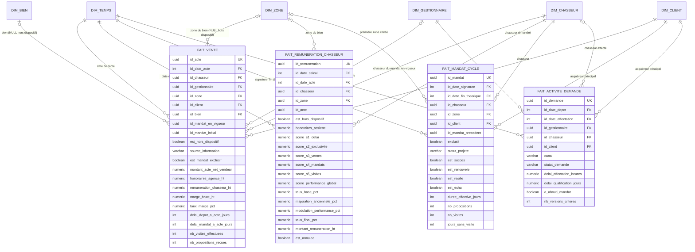

# Schéma analytique (OLAP) et alimentation — v8.42

> **Livrable BC05** (grille d'évaluation : « schéma analytique + alimentation des données : 1 schéma + description, script SQL ou code »).
> **Rédaction :** Matthieu Barre (R, schéma OLAP) · **Approbation :** Angeline Gomez (A) · **Alimentation :** Alexandre Kechaf (A du descriptif d'alimentation) — RACI v1.1.
> **Version :** 1.1 du 11/10/2026, rebasée sur le socle OLTP **v8.42** (ADR-053, décisions D10, D12, D13). Remplace la v1.0 construite sur un schéma antérieur à la v8.4 (risque RB1 de l'étude d'opportunité, constaté le 09/10 et traité ici).
> **Code :** `livrables/olap/01_schema_etoile.sql` · `02_etl_chargement.sql` · `03_vues_kpi.sql` · `tests/test_olap_pipeline.py`. Rejoué par `run_tests_docker.sh`.

## 1. Ce que l'entrepôt doit répondre

Les cinq indicateurs de l'étude d'opportunité (§2.3), tels que validés avec le Product Owner :

| KPI | Question | Vue de restitution |
|---|---|---|
| KPI-1 | Combien de demandes deviennent mandats, visites, offres, actes ? | `v_kpi_conversion_funnel` |
| KPI-2 | Quand encaisse-t-on ? Quels mandats dorment ? | `v_kpi_mandats_cycle_vie` (dont mandats sans visite depuis 30 jours, D16) |
| KPI-3 | Combien de visites avant une vente ? | `v_kpi_performance_chasseurs.visites_moyennes_par_vente` |
| KPI-4 | Quelle marge, quelle rémunération par chasseur ? | `v_kpi_chiffre_affaires_mensuel`, `v_kpi_performance_chasseurs` |
| KPI-5 | Quels secteurs performent ? | `v_kpi_analyse_geographique` |

## 2. Principes (ADR)

- **ADR-025 / ADR-036 — frontière OLTP / OLAP.** L'OLTP (`public`, 38 tables, 9 vues) est la source de vérité ; l'entrepôt (`olap`) est reconstruit depuis lui, jamais l'inverse. Aucun agrégat comparatif ne vit dans l'OLTP.
- **ADR-048 / ADR-051 — états dérivés, jamais recalculés ici.** L'ETL lit les vues d'état de l'OLTP (`v_mandat`, `v_demande`, `v_acte_mandat`, `v_honoraires`) : si la règle change dans l'OLTP, l'entrepôt la suit sans modification. C'est la parade au risque **RB1** (dérive de schéma) de l'étude d'opportunité.
- **ADR-049 / ADR-052 — rémunération gelée.** `fait_remuneration_chasseur` copie les composantes figées à l'acte (cinq notes, taux, montant). L'entrepôt n'invente aucun calcul de rémunération.
- **ADR-053 / D13 — acte à double origine, chaîne de renouvellement.** Une vente est rattachée au mandat de la chaîne **en vigueur** à l'acte (celui que rémunère l'OLTP) et au mandat **initial** (point de départ du délai S₁). Une vente hors dispositif n'a ni bien ni zone : ces clés sont nulles et `est_hors_dispositif` la distingue.
- **D10 — une visite = un rendez-vous.** Fonction `olap.f_nb_visites` : rendez-vous distincts (bien, date) réalisés avec au moins un acquéreur de la demande. Une visite en couple compte une fois ; la reconnaissance du chasseur seul ne compte pas.
- **D12 — efficacité des visites.** Les ventes hors dispositif sont exclues de la moyenne de visites par vente (KPI-3).
- **ADR-043 / RB4 — pas de donnée identifiante.** `dim_client` ne porte que des tranches (budget, âge) et le statut d'anonymisation ; `dim_chasseur` ne porte pas l'e-mail.
- **ADR-036 — compte technique.** `SYS-MIGRATION` est marqué `est_technique` et exclu des délais « humains ».

## 3. Modèle en étoile

Grain : un acte = un fait de vente ; une rémunération = un fait ; un mandat = un cycle ; une demande = une activité.



### Dimensions

| Dimension | Contenu | Source OLTP | Note |
|---|---|---|---|
| `dim_temps` | calendrier 2020-2030, jour par jour (année, trimestre, mois, semaine ISO, week-end, ouvré) | généré | clé `YYYYMMDD` |
| `dim_chasseur` | identité, statut juridique, **habilitation Hoguet** (type, numéro, organisme, validité), entrée et sortie du réseau, capacité | `chasseur`, `utilisateur` | pas d'e-mail (minimisation) |
| `dim_gestionnaire` | matricule, identité, équipe, capacité, `est_technique` | `gestionnaire`, `utilisateur` | `SYS-MIGRATION` → technique |
| `dim_zone` | type, libellé, ville, secteur, codes, département (France), **pays, code ISO, devise** | `zone` | prêt pour l'international |
| `dim_bien` | type, tranche de surface, pièces, DPE, prestations | `bien` | |
| `dim_client` | tranche de budget, destination, primo-accédant, financement, tranche d'âge, `est_anonymise_rgpd` | `client`, `demande`, `v_version_courante`, `utilisateur` | aucune donnée identifiante |

### Faits

| Fait | Grain | Mesures | Règles |
|---|---|---|---|
| `fait_vente` | un acte | montant, honoraires, part chasseur, marge, taux de marge, délais, visites, propositions | marge = honoraires − part chasseur ; délai mandat → acte depuis le mandat **initial** (D13) ; visites = rendez-vous d'acquéreurs sur la chaîne du mandat (D10) |
| `fait_remuneration_chasseur` | une rémunération | assiette, cinq notes, score, taux, montant, `est_annulee` | copie du gel OLTP (ADR-049) ; `est_hors_dispositif` |
| `fait_mandat_cycle` | un mandat | durée effective, propositions, visites, `jours_sans_visite` | état lu dans `v_mandat` ; filiation `id_mandat_precedent` |
| `fait_activite_demande` | une demande | délais d'affectation et de qualification, versions de critères, `a_abouti_mandat` | état lu dans `v_demande` |

## 4. Alimentation (`02_etl_chargement.sql`)

- **ELT en SQL ensembliste**, une transaction, `INSERT … ON CONFLICT DO UPDATE` sur la clé naturelle de chaque table : rejouable à l'identique (test d'idempotence), sans suppression.
- **Ordre** : dimensions (temps, chasseur, gestionnaire, zone, bien, client), puis faits (mandats, demandes, ventes, rémunérations).
- **Lignage** :

```
OLTP (public)                                   vue d'état lue            OLAP (olap)
mandat, mandat_reprise, proposition, visite ──▶ v_mandat ───────────────▶ fait_mandat_cycle
demande, affectation, demande_version ───────▶ v_demande ──────────────▶ fait_activite_demande
acte (2 origines), compromis…proposition ────▶ v_acte_mandat, v_honoraires ▶ fait_vente
remuneration_chasseur ───────────────────────▶ (copie du gel) ──────────▶ fait_remuneration_chasseur
chasseur, gestionnaire, zone, bien, client ──▶ (tranches, drapeaux) ────▶ dimensions
```

- **Date de référence** : les âges, durées et mandats dormants utilisent `public.date_reference()` (ADR-047), donc le même « aujourd'hui » que l'OLTP : les tests sont reproductibles.
- **Reconstruction complète** : la recette supprime le schéma `olap` et le recharge entièrement ; en production, le même script tourne en chargement nocturne (orchestrateur Airflow, étude §6.1) et ne fait que des mises à jour.

## 5. Vues de restitution (`03_vues_kpi.sql`)

| Vue | Public | Ce qu'elle donne |
|---|---|---|
| `v_kpi_chiffre_affaires_mensuel` | direction, DAF | ventes (dont hors dispositif), volume, honoraires, part chasseurs, marge, taux de marge, panier moyen, délai moyen mandat → acte |
| `v_kpi_performance_chasseurs` | direction commerciale | mandats (actifs, clos en succès), ventes, honoraires, rémunération hors annulations, cinq notes moyennes, visites moyennes par vente (hors ventes hors dispositif, D12), taux de transformation |
| `v_kpi_conversion_funnel` | pôle gestion | demandes reçues, en attente, prises en charge, transformées, sans suite ; délais humains (hors compte technique) |
| `v_kpi_mandats_cycle_vie` | juridique, direction | répartition par état, exclusivité, **mandats dormants** (actifs, > 30 jours sans visite), durée, propositions et visites moyennes |
| `v_kpi_analyse_geographique` | développement | mandats, ventes, volume, honoraires, marge et taux de succès par zone |

## 6. Tests (`tests/test_olap_pipeline.py`)

| Test | Vérifie | Jeu de test (seed) | Données reprises (migration) |
|---|---|---|---|
| structure | 6 dimensions, 4 faits, 5 vues | ✅ | ✅ |
| idempotence | rejouer l'ETL ne change aucun comptage | ✅ | ✅ |
| réconciliation mandats | volume et état identiques à `v_mandat` (RB2) | ✅ | ✅ 18 mandats : 11 échus, 3 clos en succès, 2 actifs, 2 résiliés |
| réconciliation ventes | comptage **et** montants identiques à l'OLTP (RB2) | ✅ | ✅ (0 vente reprise) |
| compte technique | `SYS-MIGRATION` technique, délais humains à NULL | — (absent) | ✅ |
| formules | marge = honoraires − part ; taux | ✅ | ✅ |
| RGPD | aucune colonne identifiante dans `dim_client` ; anonymisation reflétée | ✅ | ✅ |
| D10 | couple + chasseur + reconnaissance = **1** visite | ✅ | — (pas de proposition reprise) |
| D13 / ADR-053 | chaque vente rattachée au mandat en vigueur et au mandat initial ; une vente de la chaîne a toujours un bien | ✅ | ✅ |

Résultat au 11/10/2026 (PostgreSQL 16.15) : **8 réussis, 1 sauté** sur chaque jeu (le test sauté est celui dont la donnée n'existe pas dans le jeu). Commande : `./run_tests_docker.sh` (dernière étape), ou `pytest livrables/olap/tests` avec les variables `PG*`.

## 7. Limites et suites

- **Volumétrie** : construit et testé sur l'activité actuelle (52 lignes reprises). À la cible de l'énoncé (5 000 mandats par semaine, CDC ENF-03), les faits se partitionnent par date et les sous-requêtes corrélées de l'ETL passent en jointures agrégées ; la note de dimensionnement 3V (R : Alexandre Kechaf) doit chiffrer ce passage.
- **Chargement incrémental** : l'ETL recharge tout ; un chargement par delta (actes et mandats modifiés depuis la dernière exécution) est à prévoir avec l'orchestrateur.
- **Historisation des dimensions** : type 1 (écrasement). Les changements de chasseur ou de zone ne sont pas historisés (pas de SCD 2) : décision à acter par ADR en phase 3.
- **D13** : la lecture « chaîne de renouvellement » est appliquée ; elle attend la confirmation du Product Owner (journal des décisions).

## 8. Rattachement RNCP40573

BC05 — « Extraction, transformation, chargement, qualité, RGPD » (ETL idempotent, réconciliation, minimisation) et « concevoir la base pour l'analytique » (étoile, grain, dimensions). BC01 — frontière OLTP / OLAP tracée par ADR. BC03 — tests automatisés rejoués dans la recette.
